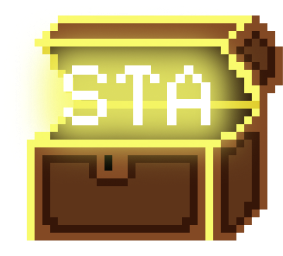

<div align="center">
  
  <h1>STA Translator Tool</h1>
  <h3>Translate <code>.sta</code> game strings. On your desktop.</h3>
  <p>Extract, translate and repack string data from proprietary <code>.sta</code> files.</p>
  <p>
    <a href="https://github.com/reviwh/sta-tool/releases/latest">Download</a> ·
    <a href="#get-started">Get started</a> ·
    <a href="#keyboard-shortcuts">Shortcuts</a> ·
    <a href="#plugins">Plugins</a>
  </p>
  <p>
    <a href="https://github.com/reviwh/sta-tool/actions/workflows/release.yml"></a>
    <a href="https://github.com/reviwh/sta-tool/releases/latest"></a>
    <a href="LICENSE"></a>
    <a href="https://www.python.org/"></a>
    <a href="https://www.riverbankcomputing.com/software/pyqt/"></a>
  </p>
</div>

## What you can do

<table>
  <tr>
    <td width="50%" valign="top">
      <strong>Extract &amp; repack</strong><br />
      Pull translatable strings out of <code>.sta</code> files into a JSON project and write them back once translated.
    </td>
    <td width="50%" valign="top">
      <strong>Project management</strong><br />
      Open, save and navigate a whole project with the integrated file tree.
    </td>
  </tr>
  <tr>
    <td width="50%" valign="top">
      <strong>CSV import / export</strong><br />
      Round-trip translations through CSV for editing in a spreadsheet or another tool.
    </td>
    <td width="50%" valign="top">
      <strong>Search &amp; replace</strong><br />
      Find and replace in the current file or across the whole project in one pass.
    </td>
  </tr>
  <tr>
    <td width="50%" valign="top">
      <strong>Plugin system</strong><br />
      Turn hex-encoded characters into readable tags with simple JSON plugins.
    </td>
    <td width="50%" valign="top">
      <strong>Dark / light themes</strong><br />
      Pick a theme, or let the app follow your system setting.
    </td>
  </tr>
</table>

## Keyboard shortcuts

<details open>
<summary><strong>All shortcuts</strong></summary>

| Shortcut | Action |
|----------|--------|
| `Ctrl+N` / `Ctrl+O` | New / open project |
| `Ctrl+S` / `Ctrl+Shift+S` | Save / save as |
| `Ctrl+W` | Close project |
| `Ctrl+I` / `Ctrl+E` | Import from / export to CSV |
| `F5` | Repack to `.sta` |
| `Ctrl+H` / `Ctrl+Shift+H` | Replace All (current file / whole project) |
| `Ctrl+Z` / `Ctrl+Y` | Undo / redo |
| `Ctrl+P` / `Ctrl+Shift+P` | Apply / remove plugin |
| `F1` | Toggle keyboard shortcuts |
| `F3` | Focus filter field |
| `Ctrl+Enter` / `Ctrl+Shift+Enter` | Next / previous string line |
| `Ctrl+Shift+,` / `Ctrl+Shift+.` | Decrease / increase font size |

</details>

## Plugins

Plugins are JSON lists that map hex-encoded characters to readable tags:

```json
[
  { "hex": "EE8080", "string": "[L-Analog]" }
]
```

The last used plugin is stored in the project settings and re-applied automatically when the project is opened.

## Get started

### Download

Pre-built binaries are available on the [Releases](https://github.com/reviwh/sta-tool/releases) page.

<details>
<summary><strong>Windows</strong> · EXE</summary>

Download `STA-Translator-Windows.exe` and run it. No installation or Python needed.

</details>

<details>
<summary><strong>Linux</strong> · binary</summary>

Download `STA-Translator-Linux`, make it executable and run it:

```sh
chmod +x STA-Translator-Linux
./STA-Translator-Linux
```

</details>

### From source

```bash
git clone https://github.com/reviwh/sta-tool.git
cd sta-tool
python -m venv venv
source venv/bin/activate  # Windows: venv\Scripts\activate
pip install -r requirements.txt
python main.py
```

### Build a standalone executable

```bash
pyinstaller app.spec
```

### Requirements

- Python 3.10+
- [PyQt6](https://pypi.org/project/PyQt6/)

## License

[MIT](LICENSE) · © 2024 Revi Wardana Putra.
